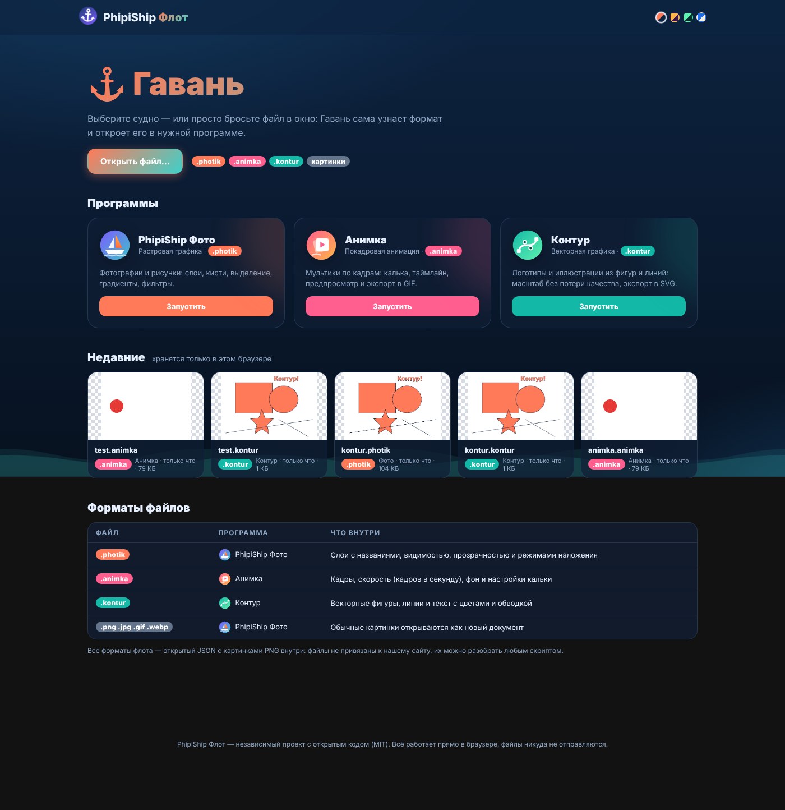
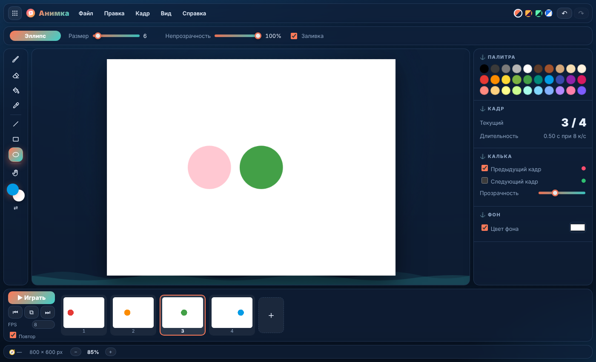
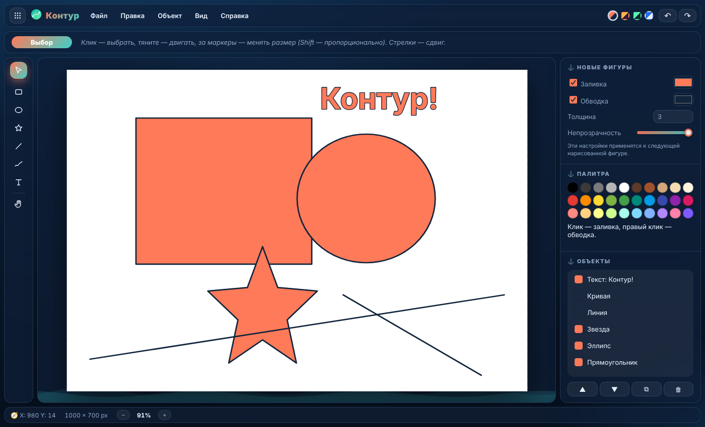

# PhipiShip Флот

**PhipiShip Флот** — бесплатный набор творческих программ, которые работают прямо в браузере.
Без установки, без сервера, без сборки. Файлы обрабатываются локально и никуда не отправляются.

| Программа | Для чего | Свой формат |
|---|---|---|
| ⚓ **Гавань** (`index.html`) | Меню всех программ, недавние файлы, открытие любого файла в нужной программе | — |
| ⛵ **PhipiShip Фото** (`photo.html`) | Растровая графика: слои, кисти, выделение, градиенты, фильтры | `.photik` |
| 🎞 **Анимка** (`animka.html`) | Покадровая анимация: калька, таймлайн, проигрывание, экспорт GIF | `.animka` |
| ✒️ **Контур** (`kontur.html`) | Векторная графика: фигуры, звёзды, линии, кривые от руки, текст, экспорт SVG | `.kontur` |



## Запуск

- Онлайн: включите **GitHub Pages** (Settings → Pages → ветка с файлами, папка `/`) и откройте ссылку — это Гавань.
- Локально: запустите любой простой сервер в папке проекта, например `python3 -m http.server`, и откройте `http://localhost:8000`.
  (Если открыть файлы двойным кликом, программы работают, но передача файлов между ними и «Недавние» могут не работать — браузеры ограничивают хранилище для `file://`.)

## Как программы работают вместе

- **Одно меню на всё.** В Гавани кнопка «Открыть файл» (или просто перетащите файл в окно) сама определяет формат
  и открывает его в нужной программе: `.photik` → Фото, `.animka` → Анимка, `.kontur` → Контур, обычные картинки → Фото.
- **Переключатель программ** — кнопка ⋮⋮⋮ слева вверху в каждой программе.
- **«Открыть…» в любой программе** понимает все форматы флота: чужой файл сам уедет в свою программу.
- **Недавние.** Сохранённые и открытые проекты появляются в Гавани с превью — клик открывает их снова.
- **Передача между программами:** Анимка → «Открыть кадры в PhipiShip Фото» (каждый кадр станет слоем),
  Контур → «Открыть в PhipiShip Фото» (векторы станут растровым слоем). Картинки можно помещать в Анимку (новым кадром) и в Контур.
- Тема оформления общая: выбрали «Закат» в одной программе — он будет во всех.

## PhipiShip Фото

| Раздел | Что есть |
|---|---|
| Инструменты | Перемещение, Выделение (прямоугольник/овал), Кадрирование, Кисть, Ластик, Заливка (с допуском), Градиент (линейный/радиальный), Пипетка, Текст, Линия, Прямоугольник, Эллипс, Рука, Масштаб |
| Выделение | Рисование, заливка, текст, градиент и фильтры работают только внутри выделения; перенос фрагмента, копировать/вырезать/вставить новым слоем, инверсия, кадрирование по выделению |
| Слои | Создание, дублирование, удаление, порядок, видимость, переименование (двойной клик), непрозрачность, 16 режимов наложения, объединение, сведение |
| Изображение | Размер изображения, размер холста с привязкой, поворот на 90°, отражение |
| Фильтры | Яркость/Контраст, Тон/Насыщенность, Обесцветить, Инверсия, Сепия, Размытие, Резкость, Шум, Пикселизация, Порог — с живым предпросмотром |
| Файлы | Проект **.photik** со всеми слоями (Ctrl+S), открыть картинку или проект, поместить как слой, перетаскивание файлов, вставка из буфера (Ctrl+V), экспорт PNG (Ctrl+Shift+S) и JPG |
| Прочее | Отмена/повтор, палитра, масштаб колесом мыши, горячие клавиши (Справка → Горячие клавиши) |

## Оформление

- Морская тема: «стеклянные» плавающие панели, покачивающийся кораблик в логотипе, волны под холстом, заставка при запуске.
- Четыре темы — переключатели справа вверху: **Ночное море**, **Закат**, **Лагуна**, **Парус** (светлая). Выбор запоминается.
- Подсказки-флажки у инструментов с горячей клавишей, курсор кисти окрашен в текущий цвет.
- На телефоне: панель слоёв открывается кнопкой ☰, масштаб и прокрутка — двумя пальцами.


## Анимка



- Кисть, ластик, заливка, пипетка, линия, прямоугольник, эллипс.
- Таймлайн с миниатюрами: добавить (N), дублировать (Ctrl+J), удалить, переставить кадры.
- **Калька**: предыдущий кадр просвечивает красным, следующий — зелёным.
- Проигрывание (Enter), скорость 1–60 кадров в секунду, повтор.
- Экспорт: **GIF** (собственный кодировщик, с прозрачностью), спрайт-лист PNG, отдельный кадр PNG.

## Контур



- Прямоугольник (со скруглением), эллипс, звезда (3–40 лучей), линия, карандаш (линия от руки сглаживается в векторную кривую), текст, картинки.
- Выбор, перемещение, изменение размера за 8 маркеров (Shift — пропорционально), отражение, порядок объектов.
- Панель свойств: заливка, обводка, толщина, прозрачность, точные X/Y/Ш/В, шрифт и кегль.
- Экспорт **SVG** и **PNG** (1×–4×).

## Форматы файлов

Все форматы — открытый JSON, картинки внутри — PNG в base64. Файлы можно разобрать любым скриптом.

| Расширение | Поле `format` | Что внутри |
|---|---|---|
| `.photik` | `"photik"` | `width`, `height`, `active`, `layers: [{ name, visible, opacity, blend, png }]` |
| `.animka` | `"animka"` | `width`, `height`, `fps`, `loop`, `background`, `onion`, `frames: [{ png }]` |
| `.kontur` | `"kontur"` | `width`, `height`, `background`, `objects: [{ type, …геометрия, fill, stroke, sw, opacity }]` |

### Подробнее о .photik

Собственный формат проекта PhipiShip — сохраняет все слои, чтобы потом продолжить редактирование.
Внутри обычный JSON:

```json
{
  "format": "photik",
  "version": 1,
  "app": "PhipiShip",
  "width": 1200,
  "height": 800,
  "active": 0,
  "layers": [
    { "name": "Фон", "visible": true, "opacity": 1, "blend": "source-over", "png": "data:image/png;base64,…" }
  ]
}
```

Слои идут снизу вверх, пиксели каждого слоя хранятся в PNG без потерь. Открыть — «Файл → Открыть» или перетащить файл в окно.

## Структура

```
index.html, hub.css, hub.js   — Гавань: меню программ, недавние, открытие любого файла
photo.html, app.js            — PhipiShip Фото
animka.html, animka.js        — Анимка
kontur.html, kontur.js        — Контур
suite.js                      — общий модуль: реестр программ и форматов, передача файлов, недавние, темы
ui.js                         — общий интерфейс Анимки и Контура: меню, окна, масштаб, палитра
style.css                     — общее оформление и четыре темы
logo.svg, icon-*.svg          — собственные значки программ
```

## Про название и права

- Весь код, интерфейс, иконки и логотипы всех программ флота написаны с нуля для этого проекта. Чужой код,
  иконки, шрифты, логотипы и элементы фирменного стиля других графических программ **не используются**.
- Названия **PhipiShip Флот**, **Анимка**, **Контур**, **Гавань** и форматы `.photik`, `.animka`, `.kontur` — собственные.
- Название **PhipiShip** оригинальное. В самом приложении нигде не упоминаются чужие
  товарные знаки, и проект не выдаёт себя за продукт другой компании.
- Похожая функциональность (слои, кисти, фильтры) сама по себе не охраняется — это общепринятые
  возможности любого графического редактора.
- Чего **не стоит** делать, чтобы так и оставалось: называть проект «Photoshop-что-то», использовать
  синий квадрат с буквами «Ps», копировать чужие иконки/скриншоты в рекламу, писать «аналог
  Photoshop» в названии приложения в сторах.
- Для набора программ — то же самое: не называть его «Creative Cloud», не делать значки в виде цветных
  квадратиков с двумя буквами (фирменный стиль Adobe). У флота свои круглые «морские» значки.
- Если планируете коммерческое использование или регистрацию бренда — проверьте название
  PhipiShip по базам товарных знаков (ФИПС/Роспатент, WIPO Global Brand Database, USPTO)
  и при необходимости проконсультируйтесь с юристом. Этот README не является юридической консультацией.

## Лицензия

MIT — см. файл [LICENSE](LICENSE).
